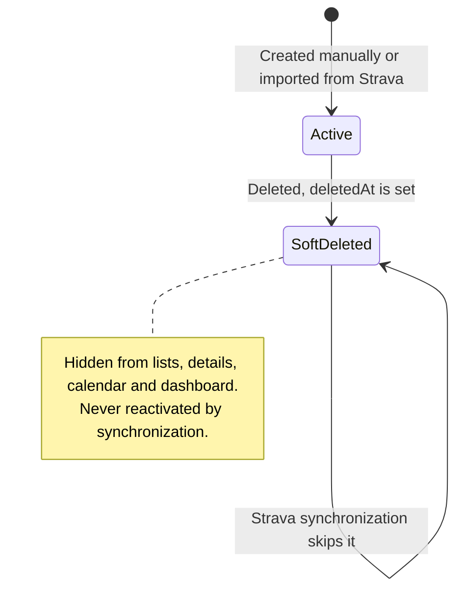

# Athlify – Activity Management Technical Details

Technical detail documentation for the functional concept in
[`CONCEPT.md`](CONCEPT.md).

The backend implements activity management (create, edit, soft delete,
filters and merges) through the GraphQL API; see
[`api-design.md`](api-design.md#activities-and-merges). The Activities page
lists, adds, edits and soft-deletes activities; the calendar view,
the merge UI and Strava synchronization are not implemented yet.

## Views and functions

- List/table view. The list shows the date and start time, type, description,
  duration, distance, bicycle, elevation gain, average speed and TSS; on wide
  screens it also shows average heart rate, effort, mood, wind, gadgets and
  tags (as chips). The source is not a column. Missing values are shown as
  "—", never as 0. Users can search descriptions and filter by an inclusive
  date range or year-to-date from the controls above the grid. Column filters
  provide text, date and numeric operators, plus checklists for type, bicycle,
  tags, wind, mood and gadgets. All filters are applied by the server and
  combine with AND semantics; multiple selected values in a checklist match
  any selected value. Filter and sort state is kept in the URL. Sorting is
  server-side across all matching activities, not only the loaded page, and
  supports multiple sort columns; newest first is the default. Type,
  description, bicycle, mood, wind, gadgets and tags are not sortable because
  their stored values would not sort in their natural order. The number of
  matching activities is shown above the grid.
- Saved views store the URL-backed filters and sort order together with column
  order, visibility, width and pinning in browser-local storage. Reset Filters
  clears filters while keeping the current sort and column layout. Reset Table
  clears filters, restores the default sort and column layout, and leaves saved
  views intact. The grid loads further cursor pages automatically when the user
  scrolls to the end; a failed page load offers an explicit retry.
- A user can temporarily pin multiple activities above the filtered results.
  Newly created activities are pinned while the server refreshes the sorted and
  filtered list; the user can also pin existing rows. Unpinning removes only
  that activity from the pinned area without changing the server-owned list.
- Table cells are directly editable for every functional input field,
  including date and start time, tags, gadgets and minimum/average/maximum
  heart rate. Calculated and system-managed values remain read-only. "Add
  activity" immediately creates a row with the most recent activity type (or
  ROAD), the current date and time, a one-minute duration, zero distance and a
  localized "New Activity" description.
  The row is pinned while the user completes it through inline cell editing.
  There is no copy function. Tags can be
  created from a small popover in the tags cell editor. Delete requires
  confirmation and warns when the activity belongs to a merge.
- Calendar view with weekly summary inspired by TrainingPeaks.
- Full CRUD for manual and synchronized activities.
- Visible Strava sync button on the Activities page.
- Display of the last synchronization time and a possible error status.

## Editability

All functional input fields are editable unless they are calculated or system-managed. System and calculated fields are marked with `*` and remain read-only wherever they are displayed.

Non-editable fields:

- `id`
- `averageSpeed`
- `tss`
- `source`
- `stravaActivityId`
- `createdAt`
- `modifiedAt`
- `mergeId`
- `deletedAt`

## Soft delete and Strava synchronization

Deleted activities are not physically removed. Instead, `deletedAt` is set.
Normal lists, detail views, calendar views and dashboard analyses include only
active activities. During Strava synchronization, an activity that was already
soft-deleted must not be created or reactivated as an active activity.
Synchronization matches external references within the authenticated owner
context and reports failures explicitly.

## Activity fields

| Field | Type/relationship | Editable |
|---|---|:---:|
| `id`* | internal ID | No |
| `userId` | owner | No |
| `date` | date and start time | Yes |
| `type` | enum or activity type | Yes |
| `vehicleId` | optional bicycle | Yes |
| `gadgetIds` | n:m to gadgets | Yes |
| `mergeId`* | optional merge, set by merging | No |
| `time` | duration | Yes |
| `distance` | distance | Yes |
| `averageSpeed`* | calculated value | No |
| `elevationGain` | elevation gain | Yes/imported |
| `tss`* | calculated Training Stress Score | No |
| `description` | description | Yes |
| `tags` | n:m to the user's tags | Yes |
| `heartRateMin` | minimum heart rate | Yes/imported |
| `heartRateMax` | maximum heart rate | Yes/imported |
| `heartRateAverage` | average heart rate | Yes/imported |
| `mood` | `VeryBad`, `Bad`, `Neutral`, `Good` or `VeryGood` | Yes |
| `effort` | subjective effort from 1 to 10 | Yes |
| `wind` | `Calm`, `Light`, `Moderate`, `Strong` or `Stormy` | Yes/imported |
| `source`* | Strava or manual | No |
| `stravaActivityId`* | external Strava reference | No |
| `createdAt`* | creation timestamp | No |
| `modifiedAt`* | modification timestamp | No |
| `deletedAt`* | soft-delete timestamp | No |

## Merging activities

Activities can be merged through a separate merge record. A merge contains at
least two activities, and an activity belongs to at most one merge. The
original activities remain available and can still be displayed individually.
If fewer than two active activities remain, the merge is dissolved. See
[`data-model.md`](data-model.md#activity-merges).

At least the following values are aggregated for the merged representation:

- Time
- Distance
- Elevation gain
- TSS

The totals cover the active activities only. They are stored on the merge and
recalculated whenever a member is added, removed, edited or soft-deleted. The
future Strava synchronization must recalculate them too when it updates a
merged activity.

## Calendar weekly summary

The calendar view groups activities by calendar week. At minimum, distance, time, elevation gain and TSS are summarized per week. The values respect the same filters as the list and dashboard views.

## Open technical learning points

- Check how Indoor and Outdoor activities from Strava can be distinguished reliably.
- Define how TSS is calculated when no power or heart-rate data is available.
